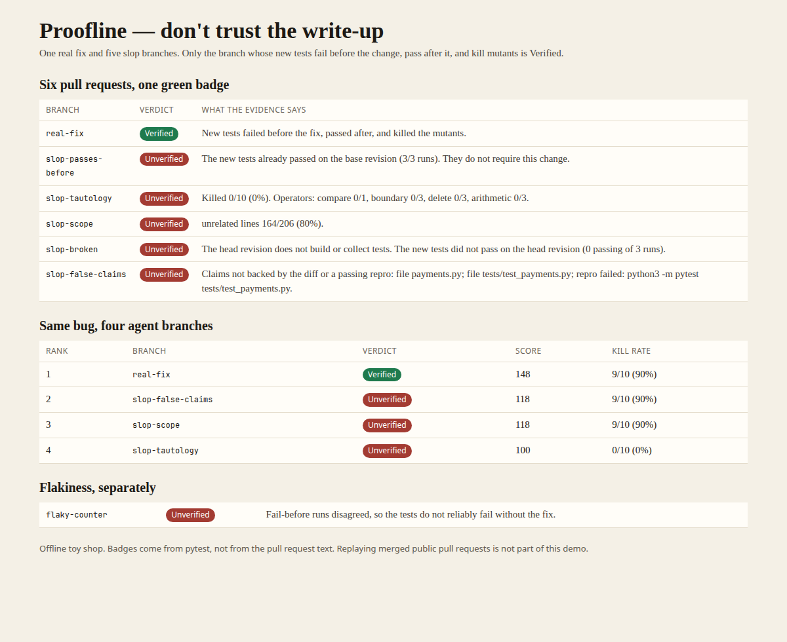
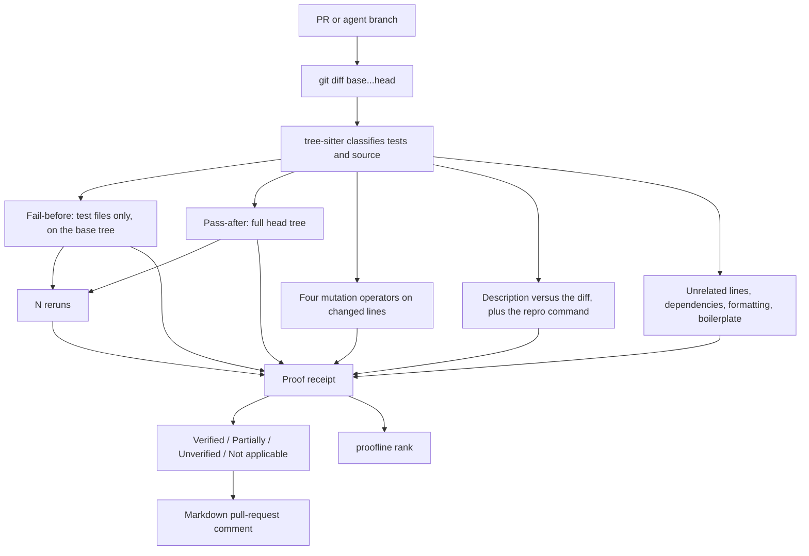
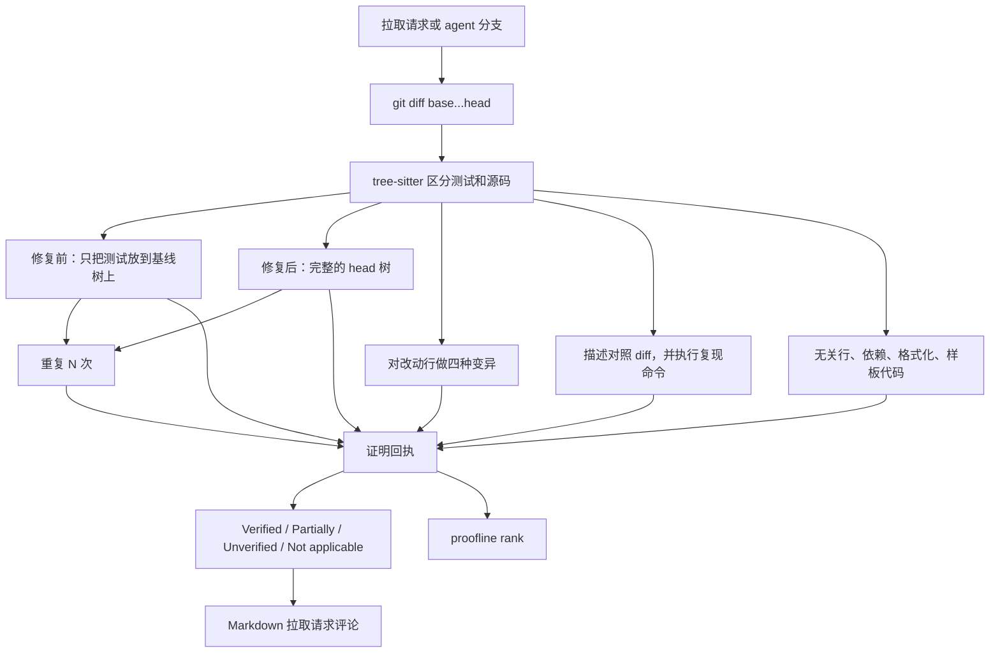

# Proofline

Don't trust the PR description. Demand a proof receipt.

Proofline checks AI-generated pull requests and parallel agent branches with deterministic execution evidence. The model's own write-up is a claim to be checked. It is not a vote.



## The pain

Code from coding agents got cheap. Checking it did not.

- [@awesomekling](https://x.com/awesomekling/status/2105814628785934386) (473 likes) on open-source projects drowning in generated pull requests.
- [@Itsfoss](https://x.com/Itsfoss/status/2107148089119363337) (63 likes): another project closed external contributions after the same flood.
- Hacker News, [AI coding agents generate more code, but not more software](https://news.ycombinator.com/item?id=50059523) (364 points).
- Claude Code [#87647](https://github.com/anthropics/claude-code/issues/87647) (102 👍): thousands of issues tagged as having a repro were closed automatically, because nobody had time to rerun them.

Surface filters such as [slopguard](https://github.com/kero168/slopguard) and [PR-slop](https://github.com/visrutsuresh/PR-slop) were 0-star projects in the survey behind this spec. They look at account age and prose, and they punish new contributors. Proofline looks at whether the new tests fail before the change, pass after it, and actually constrain the lines that moved.

## What a receipt checks

Every check is deterministic. `--llm-summary` can render a paragraph afterwards. That paragraph is not an input to the verdict.

| Check | Pass condition |
|---|---|
| Fail before | With only the new or changed tests applied to the base revision, those tests fail. |
| Pass after | The same tests pass on the head revision. |
| Mutation | On changed source lines referenced by those tests, four operators are applied: comparison swap, boundary tweak (`0→1`, otherwise `n→n+1`), statement deletion, and arithmetic/logical swap (`+↔-`, `*↔/`, `and↔or`, `&&↔\|\|`). Kill rate ≥ 50% passes, ≥ 25% warns, below that fails. |
| Claims | Files, backtick function names, and `#issue` numbers in the description appear in the diff or the branch commits. An allowlisted repro command has to exit 0. |
| Scope | Unrelated lines stay under 45%. A new dependency is named in the description. A whitespace-only sweep (at least 20 lines and 60% of the diff) fails, as does a boilerplate dump (at least 20 matching lines and 50% of additions). |
| Flake | Fail-before and pass-after are repeated N times (default 3). A disagreement fails. |

Verdicts:

- **Verified** — every applicable check passed.
- **Partially** — nothing failed, at least one check warned.
- **Unverified** — at least one check failed.
- **Not applicable** — docs-only, benchmark/perf-only, or no new behavioral tests. This is not a negative judgment.

`proofline verify` exits 0 for Verified and Not applicable, 2 for Partially, and 1 for Unverified.

`proofline rank` orders branches by evidence score: +20 for each passing check, +8 for a warning, +20×kill rate, +10 for a Verified verdict. Not-applicable branches score 0. The summary text is not an input.

## Architecture



Tree-sitter (via `github.com/smacker/go-tree-sitter`) tells test files from source and finds the statements and operators the mutator edits. The tests themselves run under the project's runner: pytest, vitest, or jest.

## Quickstart

Requirements: Go 1.22+, gcc (tree-sitter is cgo), git, and `python3 -m pytest` for Python projects. JavaScript projects need `vitest` or `jest` on the repo's `node_modules`.

```bash
python3 -m pip install pytest
make build
./bin/proofline verify --repo /path/to/repo --base main --head pr-branch
./bin/proofline rank --repo /path/to/repo --base main branch-a branch-b branch-c
```

The description is read from `--pr-body`, or from `.proofline/pr.md` on the head ref when that flag is omitted. Repro commands must start with `pytest`, `python -m pytest`, `python3 -m pytest`, `npx vitest`, `npx jest`, `npm test`, or `npm run test`.

`--llm-summary` appends a local paragraph. If `PROOFLINE_LLM_CMD` is set, that command's stdout replaces the paragraph. The verdict is already fixed before either one runs.

### GitHub Action

```yaml
- uses: actions/checkout@v4
  with:
    fetch-depth: 0
- uses: zysen1/Proofline@main
  with:
    base: main
    head: ${{ github.sha }}
    token: ${{ secrets.GITHUB_TOKEN }}
```

The action image is `Dockerfile` plus `action.yml` at the repository root. It prints the receipt and, when `token` and a pull request number are available, posts the Markdown comment. The badge in that comment is Verified, Partially, Unverified, or Not applicable.

## Offline demo

No API key.

```bash
make demo
```

`examples/toy-repo` holds six preset branch snapshots of a tiny shop. `apply_discount` raises `NotImplementedError` on `main`. `make demo` builds a git repo from those snapshots and writes:

- `docs/demo-report.html` and `docs/demo.png`
- `docs/receipts/*.md`
- `docs/rank.md`

| Branch | What the diff looks like | Receipt |
|---|---|---|
| `real-fix` | Percentage discount plus tests that state 10% of 1000 is 900 | Verified |
| `slop-passes-before` | A new test for `format_total`, which already worked | Unverified. The new test passed on `main`. |
| `slop-tautology` | A long README and a test that only checks the function returns something equal to itself | Unverified. Kill rate 0/10. Ranks last. |
| `slop-scope` | The real fix, plus analytics, a roadmap, and undeclared `requests` and `flask` | Unverified. Unrelated lines 164/206. |
| `slop-broken` | The fix with the colon missing on `def` | Unverified. The head revision does not build. |
| `slop-false-claims` | The real fix, described as a repair of `charge_card` in `payments.py` | Unverified. The named file, function, and repro are absent. |

The rank board is the four agent branches `real-fix`, `slop-false-claims`, `slop-scope`, and `slop-tautology`. On this run the order was real fix, false claims, scope creep, tautology. The prettiest write-up finished last. A separate `flaky-counter` fixture is included so the flake row is shown failing; it is not one of the six branches.

In this environment the demo command (reruns = 3, six branches plus the flake fixture, including the Go rebuild) finished in 18 seconds and produced the screenshot above.

## Measured results

Numbers below are from this workspace on 2026-10-19. Nothing here is a published benchmark from another project.

### Synthetic slop set

Command: `proofline measure --per-class 20 --reruns 2 --max-mutants 8`

Dataset: `synthetic-slop-v1` (120 generated one-module git repositories, pytest). Full JSON: [`docs/measured-results.json`](docs/measured-results.json).

Wall clock **434696 ms**. Mean **3622 ms/case**. No model API was called. Cost is local CPU time only.

A slop case is **detected** when the verdict is Unverified and that class's primary check failed. The false-positive rate is the share of `real_fix` cases judged Unverified.

| Class | N | Primary check | Verified | Partially | Unverified | Detection |
|---|---:|---|---:|---:|---:|---:|
| real_fix | 20 | — | 20 | 0 | 0 | false-positive rate 0/20 = 0 |
| passes_before | 20 | fail_before | 0 | 0 | 20 | 20/20 |
| tautology | 20 | mutation | 0 | 0 | 20 | 20/20 |
| scope_creep | 20 | scope | 0 | 0 | 20 | 20/20 |
| broken | 20 | pass_after | 0 | 0 | 20 | 20/20 |
| false_claims | 20 | claims | 0 | 0 | 20 | 20/20 |

### JavaScript adapters

`go test ./internal/verify -run TestJSAdapters` in the same session ran **6** cases (not 20 per class): vitest covered real_fix, tautology, and false_claims; jest covered passes_before, broken, and scope_creep. All 6 received the expected verdict. The one real vitest fix was Verified with 8/8 mutants killed. The five slop cases were Unverified on their primary check. This is an adapter smoke test. It is not the 120-case rate above.

### Replaying merged public pull requests

**WIP.** This run did not replay merged pull requests from public repositories. There is no field false-positive rate to report. Running that replay is future work; until it exists, the 0/20 figure above is only the synthetic `real_fix` set.

GitHub Actions billed minutes for this repository's CI are recorded on the workflow run. This measurement itself did not call a paid API.

## Limitations

- A repository with no new behavioral tests, a documentation-only diff, or a benchmark/perf-only diff is **Not applicable**. Proofline does not score those as failures.
- Kill-rate thresholds (50% / 25%) are heuristics chosen so the synthetic set separates strong tests from tautologies. They are not a universal measure of test quality.
- Mutation edits source files whose basename appears in the changed tests. Unrelated files are left to the scope check.
- A file that contains tests is treated as a test file, so a fix hidden inside a test file is not mutated.
- Repro commands outside the allowlist are rejected rather than executed.

## License

Apache-2.0. See [LICENSE](LICENSE) and [NOTICE](NOTICE). Tree-sitter and `github.com/smacker/go-tree-sitter` are MIT.

---

# Proofline

别听它说修好了，让它证明。

Proofline 用确定性的执行证据检查 AI 生成的拉取请求，以及多个并行 agent 的分支。模型写在描述里的话是待核对的声明，不是一张选票。


## 痛点

写代码变便宜了，核对没有变便宜。

- [@awesomekling](https://x.com/awesomekling/status/2105814628785934386)（473 赞）说开源项目被生成的拉取请求淹没。
- [@Itsfoss](https://x.com/Itsfoss/status/2107148089119363337)（63 赞）：又一个项目因此关闭了外部贡献。
- Hacker News：[AI coding agents generate more code, but not more software](https://news.ycombinator.com/item?id=50059523)（364 points）。
- Claude Code [#87647](https://github.com/anthropics/claude-code/issues/87647)（102 👍）：大量带有复现步骤的 issue 被自动关闭，因为没有人有时间逐个重跑。

[slopguard](https://github.com/kero168/slopguard) 和 [PR-slop](https://github.com/visrutsuresh/PR-slop) 在本规格调研时都是 0 星项目。它们看账号年龄和文风，容易误伤新人。Proofline 看的是：新增测试在改动之前是否失败、改动之后是否通过、以及这些测试是否真的约束了被修改的代码行。

## 回执里有什么

每一项都是确定性检查。`--llm-summary` 可以在判定之后补一段话。这段话不参与判定。

| 检查 | 通过条件 |
|---|---|
| 修复前失败 | 只把新增或改过的测试放到基线版本上，这些测试必须失败。 |
| 修复后通过 | 同一批测试在 head 上通过。 |
| 变异 | 对测试引用到的、发生改动的源码行使用四种算子：比较运算符替换、边界值微调（`0→1`，其余 `n→n+1`）、删除语句、算术或逻辑运算符替换（`+↔-`、`*↔/`、`and↔or`、`&&↔\|\|`）。拦下率 ≥ 50% 为通过，≥ 25% 为警告，再低则失败。 |
| 描述是否属实 | 描述里的文件、反引号中的函数名、`#issue` 必须出现在 diff 或分支提交说明里。允许名单内的复现命令必须退出码为 0。 |
| 范围 | 无关改动行低于 45%。新增依赖必须在描述里被点名。纯空白大改（至少 20 行且占 diff 的 60%）判失败；样板代码堆砌（至少 20 行且占新增行的 50%）也判失败。 |
| 稳定性 | 修复前失败和修复后通过各重复 N 次（默认 3）。结果不一致则失败。 |

判定：

- **Verified**：每一项适用的检查都通过。
- **Partially**：没有失败项，但至少有一项警告。
- **Unverified**：至少有一项失败。
- **Not applicable**：只有文档、只有基准或性能改动、或者没有新增的行为测试。这不是负面判定。

`proofline verify` 在 Verified 和 Not applicable 时退出码为 0，Partially 为 2，Unverified 为 1。

`proofline rank` 按证据分数给分支排序：每项通过 +20，每项警告 +8，再加上 20×拦下率，Verified 再 +10。不适用的分支记 0 分。摘要文字不计入分数。

## 架构



Tree-sitter（通过 `github.com/smacker/go-tree-sitter`）用来区分测试文件和源码，并定位变异要改的语句和运算符。测试本身仍交给项目自己的运行器：pytest、vitest 或 jest。

## 快速开始

需要 Go 1.22 或更高版本、gcc（tree-sitter 使用 cgo）、git，以及用于 Python 项目的 `python3 -m pytest`。JavaScript 项目需要在仓库的 `node_modules` 里提供 `vitest` 或 `jest`。

```bash
python3 -m pip install pytest
make build
./bin/proofline verify --repo /path/to/repo --base main --head pr-branch
./bin/proofline rank --repo /path/to/repo --base main branch-a branch-b branch-c
```

描述来自 `--pr-body`；省略该参数时，读取 head 上的 `.proofline/pr.md`。复现命令必须以 `pytest`、`python -m pytest`、`python3 -m pytest`、`npx vitest`、`npx jest`、`npm test` 或 `npm run test` 开头。

`--llm-summary` 会附上一段本地文字。如果设置了 `PROOFLINE_LLM_CMD`，该命令的标准输出会替换这段文字。无论哪一种，判定在此之前已经确定。

### GitHub Action

```yaml
- uses: actions/checkout@v4
  with:
    fetch-depth: 0
- uses: zysen1/Proofline@main
  with:
    base: main
    head: ${{ github.sha }}
    token: ${{ secrets.GITHUB_TOKEN }}
```

Action 镜像由仓库根目录的 `Dockerfile` 和 `action.yml` 构成。它会打印回执；在提供 `token` 和拉取请求编号时，把 Markdown 评论发到该请求上。徽章为 Verified、Partially、Unverified 或 Not applicable。

## 离线演示

不需要 API key。

```bash
make demo
```

`examples/toy-repo` 里有一家小店的六个预置分支快照。`main` 上的 `apply_discount` 会抛出 `NotImplementedError`。`make demo` 用这些快照建成一个 git 仓库，并写出：

- `docs/demo-report.html` 和 `docs/demo.png`
- `docs/receipts/*.md`
- `docs/rank.md`

| 分支 | diff 看起来像什么 | 回执 |
|---|---|---|
| `real-fix` | 百分比折扣，以及“1000 的 10% 是 900”的测试 | Verified |
| `slop-passes-before` | 给本来就正确的 `format_total` 加了一个测试 | Unverified。新测试在 `main` 上已经通过。 |
| `slop-tautology` | 一篇很长的 README，测试只检查函数返回值等于它自己 | Unverified。拦下率 0/10。排在最后。 |
| `slop-scope` | 真修复，外加分析模块、路线图，以及描述里没提到的 `requests` 和 `flask` | Unverified。无关行 164/206。 |
| `slop-broken` | 修复写了一半，`def` 少了冒号 | Unverified。head 无法构建。 |
| `slop-false-claims` | 实际是折扣修复，描述却说修好了 `payments.py` 里的 `charge_card` | Unverified。点名的文件、函数和复现命令都不存在。 |

排行榜使用四个 agent 分支：`real-fix`、`slop-false-claims`、`slop-scope`、`slop-tautology`。这一次的顺序是真修复、虚假声明、范围失控、同义反复。写得最好看的那个排在最后。另外还有一个 `flaky-counter` 夹具，用来让稳定性那一行显示失败；它不属于这六个分支。

在本环境里，演示命令（重复 3 次，六个分支加稳定性夹具，含一次 Go 重新编译）用了 18 秒，并生成上面的截图。

## 实测结果

下面的数字来自 2026-10-19 在本工作区的这次运行。它们不是从别的项目抄来的公开基准。

### 合成 slop 数据集

命令：`proofline measure --per-class 20 --reruns 2 --max-mutants 8`

数据集：`synthetic-slop-v1`（120 个生成的单模块 git 仓库，pytest）。完整 JSON：[`docs/measured-results.json`](docs/measured-results.json)。

总耗时 **434696 ms**。平均 **3622 ms/例**。没有调用任何模型 API。成本就是本地 CPU 时间。

某一类 slop **被检出**，是指判定为 Unverified，且该类的主检查失败。误报率是 `real_fix` 里被判成 Unverified 的比例。

| 类别 | N | 主检查 | Verified | Partially | Unverified | 检出 |
|---|---:|---|---:|---:|---:|---:|
| real_fix | 20 | — | 20 | 0 | 0 | 误报率 0/20 = 0 |
| passes_before | 20 | fail_before | 0 | 0 | 20 | 20/20 |
| tautology | 20 | mutation | 0 | 0 | 20 | 20/20 |
| scope_creep | 20 | scope | 0 | 0 | 20 | 20/20 |
| broken | 20 | pass_after | 0 | 0 | 20 | 20/20 |
| false_claims | 20 | claims | 0 | 0 | 20 | 20/20 |

### JavaScript 适配器

同一次会话里的 `go test ./internal/verify -run TestJSAdapters` 跑了 **6** 例（不是每类 20 例）：vitest 覆盖 real_fix、tautology、false_claims；jest 覆盖 passes_before、broken、scope_creep。6 例都得到了预期判定。那一个 vitest 真修复为 Verified，8/8 个变异被拦下。五个 slop 例都在各自的主检查上 Unverified。这是适配器冒烟测试，不是上面那组 120 例的检出率。

### 回放已合并的公开拉取请求

**WIP。** 这次没有回放公开仓库里已经合并的拉取请求，因此没有现场误伤率可以报告。那次回放是后续工作；在它完成之前，上面的 0/20 只属于合成的 `real_fix` 集合。

本仓库 CI 的 GitHub Actions 计费分钟数以工作流运行记录为准。这次测量本身没有调用付费 API。

## 局限

- 没有新增行为测试的仓库、只有文档的 diff、只有基准或性能改动的 diff，标为 **Not applicable**。Proofline 不把这些情况记成失败。
- 拦下率阈值（50% / 25%）是为了让合成集能分开强测试和同义反复测试而取的启发式，不是测试质量的通用刻度。
- 变异只改那些文件名出现在变更测试里的源码。无关文件交给范围检查。
- 含有测试的文件会整份当成测试文件，藏在测试文件里的修复不会被变异。
- 不在允许名单里的复现命令会被拒绝，不会执行。

## 许可证

Apache-2.0。见 [LICENSE](LICENSE) 和 [NOTICE](NOTICE)。Tree-sitter 与 `github.com/smacker/go-tree-sitter` 为 MIT。
